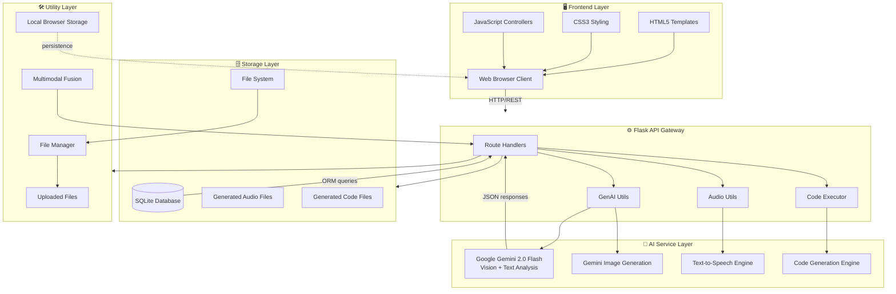

# 🎓 Multimodal Attendance & Engagement Agent

[](https://python.org)
[](https://flask.palletsprojects.com)
[](https://ai.google.dev)
[](LICENSE)
[](docs/ARCHITECTURE.md)
[](docs/ARCHITECTURE.md)

> **A privacy-preserving, AI-powered classroom presence and engagement tracking system using multimodal signals — computer vision, audio analysis, and generative AI.**

---

## 📋 Problem Statement

Traditional classroom attendance methods (paper sign-ins, roll-calls) are slow, error-prone, and provide zero insight into **student engagement**. Educators have no way to know:

- Which students are paying attention vs. distracted?
- When does engagement drop during a lecture?
- What teaching adjustments would improve outcomes in real time?
- How is attendance trending across sessions?

Manual observation is subjective, inconsistent, and impossible to scale — especially in large lecture halls or hybrid sessions.

---

## 💡 Solution Overview

The **Multimodal Attendance & Engagement Agent** combines:

| Signal | Technology | Insight |
|--------|-----------|---------|
| **Video / Computer Vision** | OpenCV + MediaPipe + Gemini Vision | Presence, head pose, attention estimation |
| **Audio** | librosa + NumPy | Voice activity, interaction level, silence |
| **Generative AI** | Google Gemini 2.0 Flash | Engagement reports, teaching suggestions, summaries |
| **Fusion** | Weighted multimodal scoring | Unified engagement score (0–100) |

All data is processed **locally** (offline-first), with Gemini API calls only for higher-level reasoning — no raw biometric data ever leaves your machine.

---

## 🎯 Key Scenarios

### Scenario 1: Automated Attendance Tracking
The system ingests a classroom video stream or uploaded recording. Using MediaPipe face detection and a custom tracking algorithm, it identifies unique individuals across frames, records their first-seen and last-seen timestamps, and computes their total presence duration — generating a complete attendance record without any manual roll-call.

### Scenario 2: Engagement and Session Dynamics Analysis
Beyond raw presence, the agent computes a real-time **Engagement Score (0–100)** by fusing:
- **Visual signals**: head pose (pitch, yaw, roll), movement, eye-region activity
- **Audio signals**: voice activity detection, interaction level, silence duration

These are aggregated into minute-by-minute windows and displayed as an **attention curve** in the analytics dashboard, revealing peaks and valleys across the session.

### Scenario 3: AI-Driven Teaching Suggestions
At any point during or after a session, the instructor can request AI-generated teaching suggestions. Gemini 2.0 Flash analyzes the engagement timeline and session context to produce actionable, personalized recommendations — e.g., *"Engagement dropped 30% after minute 25 — consider a quick interactive Q&A or a 5-minute break."*

---

## 🏗️ Architecture



---

## ✨ Features

- 📹 **Video-based attendance** — Upload classroom recordings for automated processing
- 🧠 **Real-time engagement scoring** — Fused visual + audio multimodal score (0–100)
- 📊 **Interactive analytics dashboard** — Chart.js visualizations: trend lines, pie charts, gauges
- 🎙️ **Text-to-Speech announcements** — Instructor can broadcast audio messages via gTTS
- 🤖 **AI teaching suggestions** — Gemini-powered, context-aware recommendations
- 📝 **Session reporting** — Markdown reports generated by Gemini from session data
- 💾 **SQLite persistence** — All sessions, attendance, and engagement data stored locally
- 🔒 **Privacy-first design** — No biometric data transmitted; only aggregated metrics sent to Gemini
- 🌐 **Offline-first** — Full functionality without internet; Gemini features degrade gracefully
- 📤 **CSV export** — Export attendance records for any session
- 🖥️ **Responsive UI** — Bootstrap 5 with dark sidebar, works on tablet and desktop

---

## 🛠️ Tech Stack

| Category | Technology | Version |
|----------|-----------|---------|
| Web Framework | Flask | 3.0+ |
| AI / LLM | Google Gemini 2.0 Flash | via `google-generativeai` |
| Computer Vision | OpenCV | 4.x |
| Face/Pose Tracking | MediaPipe | 0.10+ |
| Audio Analysis | librosa | 0.10+ |
| Text-to-Speech | gTTS | 2.x |
| Database ORM | SQLAlchemy / Flask-SQLAlchemy | 3.x |
| Database | SQLite | Built-in |
| Frontend Charts | Chart.js | 4.x (CDN) |
| Frontend UI | Bootstrap 5 | 5.3 (CDN) |
| Numerical Computing | NumPy | 1.x |
| Image Processing | Pillow | 10.x |

---

## 📁 Project Structure

```
Multimodel-Attendence-Engagement-Agent/
├── app.py                          # Flask application entry point
├── config.py                       # Configuration class
├── requirements.txt                # Python dependencies
├── .env.example                    # Environment variable template
├── .gitignore                      # Git ignore rules
├── README.md                       # This file
│
├── src/
│   ├── __init__.py
│   ├── ai_services/
│   │   ├── __init__.py
│   │   ├── gemini_service.py       # Gemini 2.0 Flash integration
│   │   ├── tts_service.py          # Text-to-speech via gTTS
│   │   └── code_generator.py      # AI code generation + execution
│   ├── vision/
│   │   ├── __init__.py
│   │   ├── face_tracker.py         # Face detection & tracking
│   │   └── engagement_analyzer.py # Visual engagement scoring
│   ├── audio/
│   │   ├── __init__.py
│   │   └── audio_processor.py     # Audio VAD & feature extraction
│   ├── fusion/
│   │   ├── __init__.py
│   │   └── multimodal_fusion.py   # Signal fusion logic
│   ├── storage/
│   │   ├── __init__.py
│   │   ├── database.py             # SQLAlchemy models & helpers
│   │   └── file_manager.py        # File management utilities
│   └── utils/
│       ├── __init__.py
│       ├── genai_utils.py          # GenAI helper functions
│       └── route_handlers.py      # Route handler utilities
│
├── templates/
│   ├── base.html                   # Base Bootstrap 5 template
│   ├── index.html                  # Dashboard
│   ├── attendance.html             # Attendance management
│   ├── engagement.html             # Engagement analytics
│   └── session.html                # Live session control
│
├── static/
│   ├── css/
│   │   └── style.css               # Custom styles
│   └── js/
│       ├── main.js                 # Main JavaScript controller
│       └── session.js              # Live session controller
│
├── scripts/
│   ├── setup.sh                    # Environment setup script
│   └── run.py                      # App runner
│
├── tests/
│   ├── __init__.py
│   ├── test_gemini_service.py
│   ├── test_face_tracker.py
│   └── test_fusion.py
│
├── docs/
│   ├── ARCHITECTURE.md
│   └── SCENARIOS.md
│
├── uploads/                        # Uploaded video files (gitignored)
├── generated_audio/                # TTS output files (gitignored)
└── generated_code/                 # AI-generated scripts (gitignored)
```

---

## 🚀 Installation

### Prerequisites
- Python 3.10+
- `pip` package manager
- A Google Gemini API key ([get one here](https://ai.google.dev))

### Quick Setup

```bash
# 1. Clone or navigate to the project
cd Multimodel-Attendence-Engagement-Agent

# 2. Run the automated setup script
chmod +x scripts/setup.sh
./scripts/setup.sh

# 3. Configure your environment
cp .env.example .env
# Edit .env and add your GEMINI_API_KEY

# 4. Run the application
python scripts/run.py
```

### Manual Setup

```bash
# Create and activate virtual environment
python -m venv venv
source venv/bin/activate      # Linux/macOS
# venv\Scripts\activate       # Windows

# Install dependencies
pip install -r requirements.txt

# Initialize database
python -c "from src.storage.database import init_db; init_db()"

# Start the app
python app.py
```

Open your browser at **http://localhost:5000**

---

## 🖥️ Usage

### 1. Dashboard
Navigate to `/` to see session statistics, engagement trends, and quick actions.

### 2. Start a Live Session
Go to `/session`:
1. Click **"Start Session"** and enter a session name
2. Upload a classroom video (MP4/AVI/MOV) via drag-and-drop
3. Monitor real-time stats: face count, engagement score, audio activity
4. Use the TTS panel to broadcast announcements
5. Click **"Stop Session"** to finalize

### 3. View Attendance
Navigate to `/attendance`:
1. Select a session from the dropdown
2. Review the attendance table with duration and engagement metrics
3. Export to CSV for your records

### 4. Engagement Analytics
Navigate to `/engagement`:
1. Select a session to view the engagement timeline
2. Review AI-generated teaching suggestions
3. Compare visual vs audio signal contributions

---

## 🔑 Environment Variables

| Variable | Description | Default |
|----------|-------------|---------|
| `GEMINI_API_KEY` | **Required** — Your Google Gemini API key | — |
| `FLASK_SECRET_KEY` | Flask session secret (change in production) | auto-generated |
| `FLASK_DEBUG` | Enable debug mode | `True` |
| `FLASK_PORT` | Port to run the app | `5000` |

See [`.env.example`](.env.example) for the full template.

---

## 🔒 Privacy & Ethical Design

This system is built with privacy as a first-class concern:

1. **No cloud storage of biometrics** — Face detection and tracking runs entirely on your local machine. Raw video frames are never transmitted to any external service.
2. **Aggregated metrics only** — Only numerical engagement scores and anonymized session summaries are sent to Gemini API, never video or audio recordings.
3. **Local-first storage** — All data is stored in a local SQLite database under your control.
4. **Informed use** — This system is intended for use with the knowledge and consent of all participants.
5. **Data deletion** — All session data can be deleted via the admin panel or by removing the SQLite database file.
6. **Open source** — The full codebase is auditable.

> ⚠️ **Ethical Notice**: Always obtain informed consent from all participants before recording or analyzing classroom sessions. Check your institution's privacy policies and applicable laws (FERPA, GDPR, etc.) before deployment.

---

## 🤝 Contributing

Contributions are welcome! Please:

1. Fork the repository
2. Create a feature branch: `git checkout -b feature/my-feature`
3. Make your changes with tests
4. Run tests: `python -m pytest tests/`
5. Submit a pull request

Please ensure all contributions maintain the privacy-first design principles.

---

## 📄 License

This project is licensed under the **MIT License** — see the [LICENSE](LICENSE) file for details.

```
MIT License — Copyright (c) 2024 Multimodal Attendance Agent Contributors
```

---

*Built with ❤️ using Google Gemini 2.0 Flash, Flask, OpenCV, and MediaPipe*
