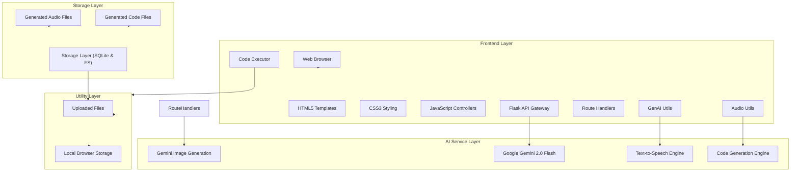

# 🏛️ System Architecture: Multimodal Attendance & Engagement Agent

This document details the architectural design of the **Multimodal Attendance & Engagement Agent**, strictly adhering to the 4-layer system design specifications.

---

## 📐 High-Level Architecture Diagram

---

## 🔍 Detailed Layer Breakdown

### 1. Frontend Layer
The presentation and request dispatch layer runs across the client's browser and the Flask application gateway.
- **HTML5 Templates**: Semantic pages for Dashboard, Attendance, Engagement Analytics, and Live Session views (`templates/`).
- **CSS3 Styling**: Modern dark-themed dashboard aesthetics with responsive layouts and visual indicators (`static/css/style.css`).
- **JavaScript Controllers**: Client-side logic for real-time dashboard polling, Chart.js metric rendering, video upload handling, and audio control (`static/js/main.js`, `static/js/session.js`).
- **Flask API Gateway & Route Handlers**: REST API handling incoming client requests, orchestrating data flow, and returning structured JSON payloads or rendered templates (`app.py`, `src/utils/route_handlers.py`).
- **GenAI Utils & Audio Utils**: Intermediate processing utilities preparing prompts, media formats, and audio streams for downstream model consumption (`src/utils/genai_utils.py`, `src/audio/audio_processor.py`).
- **Code Executor**: Local execution sandbox for executing runtime analytics code scripts dynamically generated by the AI services (`src/ai_services/code_generator.py`).

### 2. AI Service Layer
Provides multimodal reasoning, generative vision/text generation, and speech synthesis.
- **Google Gemini 2.0 Flash**: High-speed multimodal LLM invoked for frame reasoning, visual posture evaluation, contextual engagement analysis, and lecture summaries (`src/ai_services/gemini_service.py`).
- **Gemini Image Generation**: Used for generating visual lecture badges, educational illustrations, and engagement reports.
- **Text-to-Speech Engine**: Uses `gTTS` to translate instructor notices, alert prompts, and assistive announcements into audio files (`src/ai_services/tts_service.py`).
- **Code Generation Engine**: Automatically creates custom data science analysis scripts and statistical visualizations on demand based on specific classroom query requirements (`src/ai_services/code_generator.py`).

### 3. Storage Layer
Guarantees local data persistence and offline operation.
- **Generated Audio Files**: Stores synthesized MP3 audio announcements and audio reports (`generated_audio/`).
- **Generated Code Files**: Stores runtime python scripts generated for deep cohort analytics (`generated_code/`).
- **Storage Layer (SQLite Database)**: Local relational database managing sessions, timestamped attendance records, engagement telemetry, and AI suggestions (`src/storage/database.py`).

### 4. Utility Layer
Supporting modules and persistence layers that bridge device storage with application services.
- **Uploaded Files**: Secure storage for classroom video captures and audio recordings awaiting batch inference (`uploads/`).
- **Local Browser Storage**: Client-side caching of active session states, client-selected filters, and UI preference settings.
- **Multimodal Fusion Engine**: Real-time mathematical fusion balancing weighted visual engagement scores with audio activity rates (`src/fusion/multimodal_fusion.py`).

---

## 🔒 Privacy & Offline Operation

1. **Local Face Tracking**: All face detection and head pose computations are executed strictly on the edge using OpenCV and MediaPipe.
2. **Zero Biometric Streaming**: Raw biometric features and raw video feeds are never transmitted outside the local machine.
3. **Aggregated Telemetry**: Only aggregated numerical metrics (e.g., attention percentage, turn-taking counts) are provided to the Gemini reasoning engine for generating teaching suggestions.
